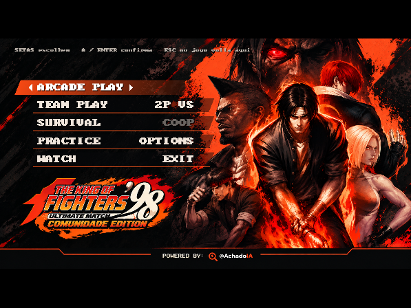
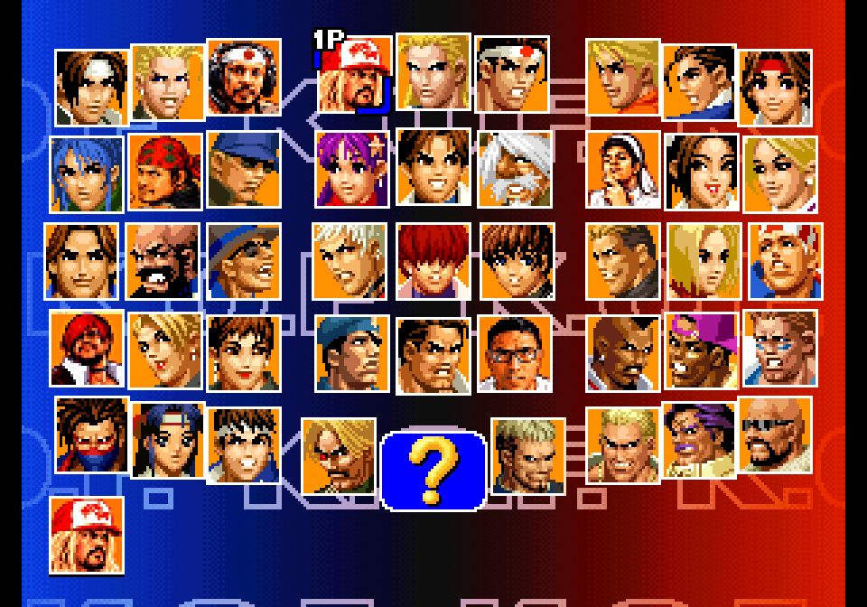
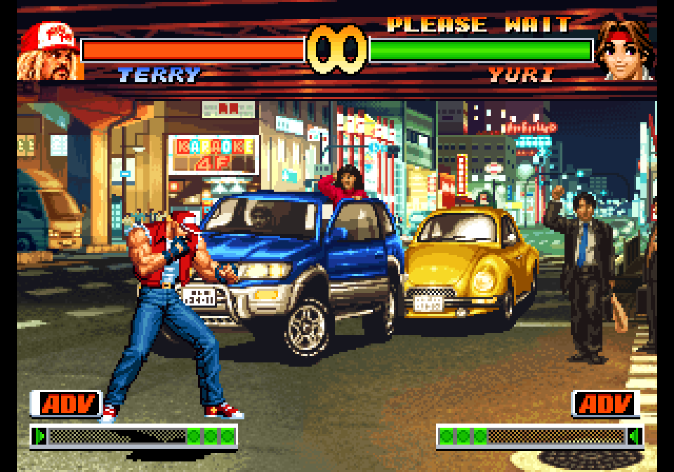
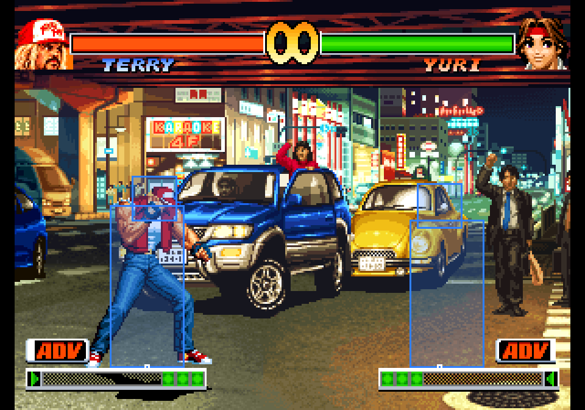

# The King of Fighters '98 — Ultimate Match Comunidade Edition

Recompilação nativa pra PC do **KOF '98 Anniversary Edition** feita pela comunidade, com homenagens aos
streamers brasileiros de KOF. **Um arquivo só** (`KOF98-Comunidade-Edition.exe`): abriu, funcionou. Sem
instalar, sem emulador por fora, sem DLL.

## Homenagens aos streamers

Lutadores com nome e retrato novos, na seleção, na tela de VS e ao lado da barra de vida:

| No jogo | Era | Homenagem |
|---|---|---|
| **Terry Urameshi** | Terry Bogard | Roberto Urameshi |
| **Orochi Daimon** | Goro Daimon | Nane Orochimaru |
| **Ralfecinha** | Ralf Jones | Kbecinha |
| **Chizurinho** | Chizuru Kagura | Helinho PE |
| **Lau Yagami** | Iori Yagami | Lau Yagami |
| **Toma Saisyu** | Saisyu Kusanagi | Tomasu |

Quer entrar no jogo também, ou tem ideia de personagem, golpe ou modo? Chama no WhatsApp:
**[(21) 96956-8854](https://wa.me/5521969568854)**. O projeto é da comunidade e vai ganhando coisa nova.

## O que mudou em relação ao jogo original

### Melhorias
- **Menu inicial novo** (Arcade, Team Play, 2P VS, Survival, Practice, Options, Watch), com arte própria.
  Esc no jogo volta pro menu.
- **Sem lentidão**: CPU do Neo Geo fixa em 200%, o jogo nunca engasga como no fliperama.
- **Configurações (F1)**: filtros de imagem (xBR com bordas em curva — o visual padrão —, nítido, suave, linhas de TV, tubo CRT, fliperama), proporção,
  tela cheia, controles remapeáveis por jogador (teclado e qualquer controle, com assistente passo a passo),
  som, escolha de cenário.
- **Treino avançado (F6)**: hitboxes, boneco P2 (parado, agachado, defendendo, pulando), gravação do
  adversário (F7 grava, F8 toca), histórico de comandos, vida e barra infinitas, salvar/carregar estado (F5/F9).
- **Trilha trocável**: `.ogg/.mp3/.wav` na pasta `som/musica` com o código da música no nome toca no lugar da
  original; `som/efeitos` faz o mesmo com vozes e efeitos. (Quem tem o KOF '98 UM Final Edition na GOG pode
  importar músicas, vozes e efeitos dele com `tools/importar_um.py`.)
- **Modo console**: abre como o Neo Geo de casa (AES), com Practice e todos os modos.

### Correções de bugs do Anniversary
- **Daimon**: o Jirai Shin não trava mais no levantar; a "frota invencível" (ficar sem caixa de dano depois do
  J.B) foi corrigida.
- **Inbloqueável de projétil + teleporte/agarrão** corrigido.
- **Cenário da rua com carros**: a tela ficava preta com uma listra a cada ~14 s (um erro na animação do cenário
  do próprio Anniversary). Corrigido.
- **Faixa preta** no canto esquerdo (sprite fantasma) eliminada.

### Balanceamento
- **Chizuru** enche a barra 30% mais devagar.
- **Modo EXTRA**: o pouso do pulinho ganhou +6 quadros (contra o laço infinito no canto).

### Mais fluido que o fliperama (v1.1.0)
- **Run-ahead**: o EXE emula 1 quadro à frente e volta (F1 → Melhorias, até 2): o golpe sai 1-2 quadros antes do que no Neo Geo.
- **Ritmo do monitor**: o jogo roda a 60 Hz casado com o vsync (sem o engasgo de 59,19 Hz na tela de 60; 120 Hz também).
- **Sprites sem limite**: nada some em cena cheia (o hardware cortava em 96 por linha).
- Menu Comunidade Edition com som e **no lugar do MODE SELECT original sempre** (Start no título, saída do OPTION, fim de jogo).
- **Nenhuma tela do jogo entre o menu e a seleção**: a tela CONTROLS e os logos são pulados atrás do "CARREGANDO".
- **Fotos dos homenageados em HD** (v1.4.0): na grade de seleção e no rosto ao lado da barra de vida, a foto real do youtuber aparece por cima, nítida em qualquer resolução (F1 → Vídeo liga/desliga). A tela de ordem fica com a arte original.
- **Qualquer controle** (v1.2.2): Xbox, Switch Pro, PlayStation, 8BitDo... são reconhecidos pelo nome dos botões, então a configuração vale pra todos. Troque de controle e continua funcionando. No F1 → Controles o rodapé mostra o que o controle está mandando na hora.
- **Menu com F1**: as configurações abrem também por cima do menu inicial. O tema de abertura toca contínuo no menu (a 50%), sem ser cortado.
- **ORDER SELECT em duas etapas** (v1.3.0): primeiro "ESCOLHA O MODO", com cursor visível em cada um dos 3 personagens
  (cima/baixo escolhe quem, esquerda/direita troca ADVANCED / EXTRA / SPECIAL, A confirma); depois "ESCOLHA A ORDEM":
  o botão desenhado ao lado de cada retrato (**A** vermelho em cima, **B** amarelo no meio, **C** verde embaixo) escolhe quem começa, em segredo. As colunas ficam congeladas até os dois
  terminarem, então ninguém sabe a ordem do outro.

### Jogo online (v1.5.0, código curto na v1.6.0)
- **ONLINE** no menu: um jogador escolhe **CRIAR SALA** e recebe um código de **3 números + 3 letras** (ex.: `504XBP`,
  já copiado pra área de transferência); manda pelo WhatsApp. O outro escolhe **ENTRAR COM CÓDIGO**, digita e Enter.
  A luta roda direto entre os dois PCs (o achadoia.com só guarda o endereço por trás do código, por 2 horas).
  Quem cria joga de 1P, quem entra de 2P.
- **Controle**: cada um usa o controle que configurou como Jogador 1 no seu F1. O jogo troca os lados por baixo.
- Netcode por atraso fixo (lockstep): o atraso é calculado pelo ping (ou fixo em F1 → Melhorias) e os dois jogos
  rodam quadro a quadro iguais; no canto da tela aparece ping e atraso, e um aviso se o estado divergir.
- Depois da luta o menu volta nos dois; o anfitrião escolhe 2P VS de novo (ou EXIT pra encerrar a sala).
- Roteador chato? Os dois lados furam o NAT ao mesmo tempo (o site passa o endereço do convidado pro anfitrião) e o
  anfitrião ainda tenta abrir a porta por UPnP. Última saída: Radmin VPN / ZeroTier e digitar `ip:porta` no lugar
  do código (porta 7998).
- **Filtro xBR** (padrão): bordas em curva, no estilo dos shaders xBR dos emuladores. F4 troca na hora.

### Atualização automática (v1.6.0)
- Ao abrir, o jogo confere se tem versão nova aqui no GitHub. Se tiver, pergunta na hora: **ENTER** baixa o EXE
  novo, troca o arquivo e reabre o jogo sozinho; **ESC** deixa pra depois. Pra jogar online os dois precisam estar
  na mesma versão.

### Por vir
- Modo COOP.
- Cenários do KOF '98 UM.
- Mais homenagens: manda a sua ideia no WhatsApp.

## Como jogar

1. Baixe o `KOF98-Comunidade-Edition.exe` na aba **Releases** e coloque numa pasta.
2. Na mesma pasta (ou numa pasta `roms` ao lado), coloque os arquivos **da sua cópia** do jogo:
   - `kof98ae2016.zip` — The King of Fighters '98 Anniversary Edition 2016 (o FBNeo chama de `kof98ae`);
   - `kof98.zip` — The King of Fighters '98 original. **Obrigatório**: o Anniversary é um "clone" e usa os
     sprites `242-c3`/`242-c4` e o áudio `242-v1` a `242-v4` desse zip (sem ele, personagens como a Yuri ficam
     invisíveis e o chip toca vozes trocadas e ruído). Se o seu `kof98ae2016.zip` já tiver esses arquivos dentro,
     o `kof98.zip` não é necessário;
   - `neogeo.zip` — BIOS do Neo Geo (com `neo-epo.bin`, `sfix`, `sm1` e `000-lo`).
   
   Faltando qualquer arquivo, o programa avisa qual é e não abre.
   
   **Nenhum arquivo do jogo vem aqui.** O programa não baixa nem indica onde conseguir ROM.
3. Abra o EXE. Se o Windows reclamar, clique em *Mais informações → Executar assim mesmo*.

Controles padrão: setas + Z X C V (A B C D), 1 = Start, 5 = moeda; controle de Xbox funciona direto
(X=A, Y=B, A=C, B=D). Tudo muda no **F1**.

## Pra quem quer mexer

O código do port fica em `port/` (C + SDL2, compilado com Zig). `port/LEIAME.md` explica a arquitetura;
`tools/` tem os scripts de patch da ROM, retratos (`retratos.py`), nomes (`renomear.py`) e importação do UM.
Compilar: `cd port && ./baixar_deps.sh && SOLO=1 ./build.sh`.

Bibliotecas: Musashi (68000), superzazu/z80, ymfm (YM2610), miniz, stb, dr_libs. Referência de hardware:
driver Neo Geo do MAME. O código deste projeto é MIT; KOF '98 é marca da SNK.

Powered by **@AchadoIA** — [achadoia.com](https://achadoia.com) · [YouTube](https://youtube.com/@achadoia) · [Instagram](https://instagram.com/achadoia)
